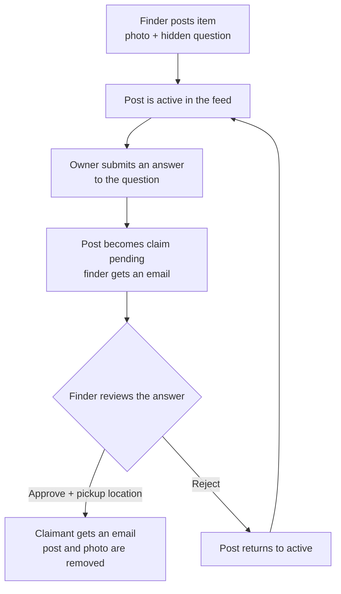

# Campus Lost & Found

A privacy-first web app that helps students get lost belongings back. A finder posts a photo of the item and a **hidden verification question**. The real owner proves it is theirs by answering that question, and the finder approves the claim and arranges the handover.

> Built with React, Node.js, Express and MongoDB.

<!-- Add a screenshot or GIF here, e.g.  -->

---

## Table of contents

- [Features](#features)
- [How it works](#how-it-works)
- [Tech stack](#tech-stack)
- [Project structure](#project-structure)
- [Getting started](#getting-started)
- [Environment variables](#environment-variables)
- [Available scripts](#available-scripts)
- [API reference](#api-reference)
- [Data models](#data-models)
- [Security](#security)
- [Deployment](#deployment)
- [Roadmap](#roadmap)
- [Contributing](#contributing)
- [License](#license)

---

## Features

**Accounts**
- Register and log in with Student ID, campus email and password
- **Sign in with Google** (accounts are created automatically on first sign-in)
- Password reset by email (single-use link that expires)
- Welcome/login page shown first, with a "Continue as guest" option

**Posting and finding items**
- Post a found item with a photo, category, location, optional description and a verification question
- Photos are stored on **Cloudinary** and optimized automatically
- Search, category filters and "Load more" pagination
- Time-ago labels and loading skeletons for a smooth feed

**Claiming items**
- Claim an item by answering its verification question (the answer is never shown publicly)
- You cannot claim your own post, and you cannot claim the same item twice
- The finder reviews the claim, then approves it (the claimant receives the pickup location by email) or rejects it (the post reopens for others)
- Claimants can withdraw a pending claim
- Finders see a badge with the number of claims waiting for them

**My Activity**
- One page with your own posts and your own claims and their status

**Moderation**
- Any user can report a post (spam, inappropriate, misleading, other)
- An **admin panel** lists reports, lets admins dismiss a report or delete the post

**Housekeeping**
- Old unclaimed posts are removed automatically (default 60 days), together with their photos and claims

---

## How it works



---

## Tech stack

| Layer | Technology |
|---|---|
| Frontend | React 19, Vite, Axios, react-hot-toast, `@react-oauth/google` |
| Backend | Node.js, Express |
| Database | MongoDB with Mongoose |
| Auth | JWT, bcrypt password hashing, Google Identity Services |
| Image storage | Cloudinary |
| Email | Nodemailer (Gmail) |
| Security | helmet, express-rate-limit, CORS allow-list |

---

## Project structure

```
lost-and-found/
├── package.json                 # root scripts (run both apps together)
├── README.md
├── backend/
│   ├── server.js                # app entry: middleware, rate limits, routes, DB
│   ├── .env.example
│   └── src/
│       ├── config/jwt.js        # loads JWT_SECRET (refuses to start without it)
│       ├── controllers/         # auth, post, claim, report logic
│       ├── middlewares/         # auth, admin-only, image upload
│       ├── models/              # User, Post, Claim, Report
│       ├── routes/              # auth, posts, claims, admin
│       └── utils/               # cloudinary, sendEmail, expired-post cleanup
└── frontend/
    ├── index.html
    ├── .env.example
    └── src/
        ├── components/          # AuthModal, PostCard, ClaimModal, modals...
        ├── context/             # AuthContext (login state)
        ├── pages/               # Feed, MyActivity, AdminPage
        ├── services/api.js      # all API calls
        └── utils/               # time helpers
```

---

## Getting started

### Prerequisites
- [Node.js](https://nodejs.org) 18 or newer
- A MongoDB database: local MongoDB or a free [MongoDB Atlas](https://www.mongodb.com/atlas) cluster
- A [Cloudinary](https://cloudinary.com) account (free)
- A Google Cloud project with an OAuth Client ID (for Google sign-in)
- A Gmail account with an App Password (for emails)

### 1. Clone and install
```bash
git clone https://github.com/YOUR-USERNAME/campus-lost-and-found.git
cd campus-lost-and-found
npm install            # installs the root helper (concurrently)
npm run install:all    # installs backend and frontend dependencies
```

### 2. Set up environment files
```bash
cp backend/.env.example backend/.env
cp frontend/.env.example frontend/.env
```
On Windows, copy and rename the files by hand. Then fill in the values (see [Environment variables](#environment-variables)).

### 3. Get your keys

**Google Client ID**
1. Open [Google Cloud Console](https://console.cloud.google.com) and go to **Google Auth Platform**.
2. Open **Clients** then **Create client** and choose **Web application**.
3. Under **Authorized JavaScript origins**, add `http://localhost:5173` (and your live URL later). Use no trailing slash and no spaces.
4. Copy the Client ID into **both** `.env` files.
5. In **Audience**, add test users while the app is in Testing mode, or publish the app.

**Cloudinary**: copy the Cloud name, API Key and API Secret from the dashboard.

**Gmail App Password**: enable 2-step verification on the Google account, then create an App Password and use it as `EMAIL_PASS` (not your normal password).

**JWT secret**: generate a strong one with
```bash
node -e "console.log(require('crypto').randomBytes(48).toString('hex'))"
```

### 4. Run the app
```bash
npm run dev
```
- Frontend: http://localhost:5173
- API: http://localhost:5000 (health check at `/api/health`)

### 5. Create an admin (optional)
Register a normal account first, then promote it in the database, for example with `mongosh`:
```js
db.users.updateOne({ studentId: "your_student_id" }, { $set: { role: "admin" } })
```
Log in again and an admin option appears in the header.

---

## Environment variables

### `backend/.env`

| Variable | Required | Description |
|---|---|---|
| `PORT` | No | Server port (default `5000`) |
| `MONGO_URI` | Yes | MongoDB connection string |
| `JWT_SECRET` | Yes | Secret used to sign login tokens. The server will not start without it |
| `CLIENT_URL` | Yes | Allowed frontend origin for CORS, e.g. `http://localhost:5173` (no trailing slash) |
| `EMAIL_USER` | Yes | Gmail address used to send emails |
| `EMAIL_PASS` | Yes | Gmail App Password |
| `GOOGLE_CLIENT_ID` | Yes | Google OAuth Client ID (verifies Google sign-ins) |
| `CLOUDINARY_CLOUD_NAME` | Yes | Cloudinary cloud name |
| `CLOUDINARY_API_KEY` | Yes | Cloudinary API key |
| `CLOUDINARY_API_SECRET` | Yes | Cloudinary API secret |
| `POST_EXPIRE_DAYS` | No | Days before an unclaimed post is removed (default `60`) |
| `NODE_ENV` | No | Set to `production` when deployed behind a proxy |

### `frontend/.env`

| Variable | Description |
|---|---|
| `VITE_API_URL` | Backend API base URL, e.g. `http://localhost:5000/api` |
| `VITE_GOOGLE_CLIENT_ID` | The same Google OAuth Client ID |

> Never commit `.env` files. Only the `.env.example` files belong in Git.

---

## Available scripts

Run from the project root:

| Command | What it does |
|---|---|
| `npm run install:all` | Install backend and frontend dependencies |
| `npm run dev` | Start backend and frontend together |
| `npm run dev:backend` | Start only the API |
| `npm run dev:frontend` | Start only the React app |
| `npm run build` | Build the frontend for production |
| `npm start` | Start the API in production mode |

---

## API reference

Base URL: `/api`. Routes marked 🔒 need an `Authorization: Bearer <token>` header.

### Auth
| Method | Endpoint | Description |
|---|---|---|
| POST | `/auth/register` | Create an account |
| POST | `/auth/login` | Log in with Student ID and password |
| POST | `/auth/google` | Log in or sign up with a Google credential |
| GET | `/auth/me` 🔒 | Current user (includes role) |
| POST | `/auth/forgot-password` | Email a reset link (5 requests per hour per IP) |
| POST | `/auth/reset-password` | Set a new password using the emailed token |

### Posts
| Method | Endpoint | Description |
|---|---|---|
| GET | `/posts` | List active posts. Query: `category`, `search`, `page`, `limit` (max 50) |
| GET | `/posts/mine` 🔒 | Posts created by the current user |
| POST | `/posts` 🔒 | Create a post (`multipart/form-data` with an `image` file) |
| POST | `/posts/:id/report` 🔒 | Report a post |
| DELETE | `/posts/:id` 🔒 | Delete your own post |

### Claims
| Method | Endpoint | Description |
|---|---|---|
| POST | `/claims` 🔒 | Submit a claim with your answer |
| GET | `/claims/mine` 🔒 | Your claims |
| GET | `/claims/pending-count` 🔒 | Pending claims waiting on your posts |
| GET | `/claims/post/:postId` 🔒 | Claims on one of your posts (finder only) |
| POST | `/claims/resolve` 🔒 | Approve (with pickup location) or reject a claim (finder only) |
| DELETE | `/claims/:id` 🔒 | Withdraw your pending claim |

### Admin (🔒, admin role only)
| Method | Endpoint | Description |
|---|---|---|
| GET | `/admin/reports` | List reports |
| POST | `/admin/reports/:id/dismiss` | Dismiss a report |
| DELETE | `/admin/posts/:id` | Delete a reported post |

### Health
| Method | Endpoint | Description |
|---|---|---|
| GET | `/health` | API status check |

---

## Data models

| Model | Key fields |
|---|---|
| **User** | `studentId` (unique), `email` (unique), `password` (hashed, empty for Google users), `googleId`, `authProvider`, `role` (`user` or `admin`), reset-token hash and expiry |
| **Post** | `finder_id`, `image_url`, `image_public_id`, `location_found`, `category`, `description`, `verification_question`, `status` (`active`, `claim_pending`, `resolved`) |
| **Claim** | `post_id`, `claimant_id`, `verification_answer`, `status` (`pending`, `approved`, `rejected`). One claim per person per post |
| **Report** | `post_id`, `reporter_id`, `reason`, `details`, `status` (`open`, `dismissed`). One report per person per post |

---

## Security

- Passwords are hashed with bcrypt, and Google ID tokens are verified on the server
- JWT login tokens expire after 7 days, and the server refuses to start without `JWT_SECRET`
- Rate limiting: 20 login or register attempts per 15 minutes, 300 API requests per 15 minutes, and 5 reset emails per hour per IP
- `helmet` security headers and a CORS allow-list limited to `CLIENT_URL`
- Image uploads are limited to image files under 5 MB
- Password reset tokens are stored hashed, are single-use and expire
- Verification answers are only visible to the finder of that post

---

## Deployment

A typical free setup:

| Part | Suggested host |
|---|---|
| Database | MongoDB Atlas (allow your backend host in Network Access) |
| Backend | Render or Railway (root: `backend`, start command: `npm start`) |
| Frontend | Vercel or Netlify (root: `frontend`, build: `npm run build`, output: `dist`) |

Checklist:
1. Set all backend environment variables on the backend host, with `NODE_ENV=production`.
2. Set `CLIENT_URL` to your live frontend URL, with no trailing slash.
3. Set `VITE_API_URL` (your backend URL plus `/api`) and `VITE_GOOGLE_CLIENT_ID` on the frontend host.
4. Add the live frontend URL to **Authorized JavaScript origins** in Google Cloud.
5. Use fresh secrets in production, not your development ones.

---

## Roadmap

- [ ] "Lost item" posts and automatic match suggestions
- [ ] In-app notifications
- [ ] Automated tests
- [ ] Dark mode

---

## Contributing

1. Create a branch: `git checkout -b feat/your-feature`
2. Commit using [Conventional Commits](https://www.conventionalcommits.org): `feat:`, `fix:`, `docs:`, `chore:`
3. Push the branch and open a Pull Request

---

## License

ISC

## Author

Built by **Kapil**, B.Tech CSE student at Uttaranchal Institute of Technology.
